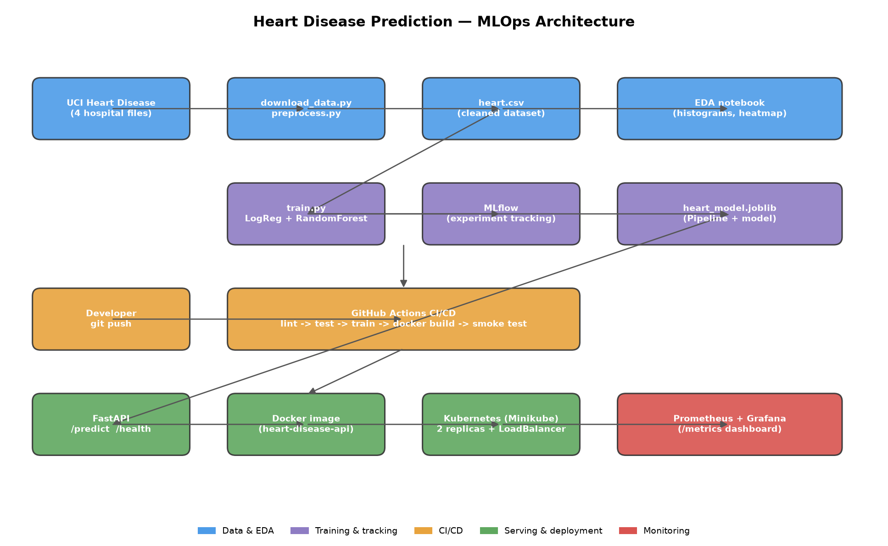
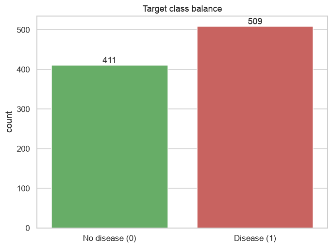
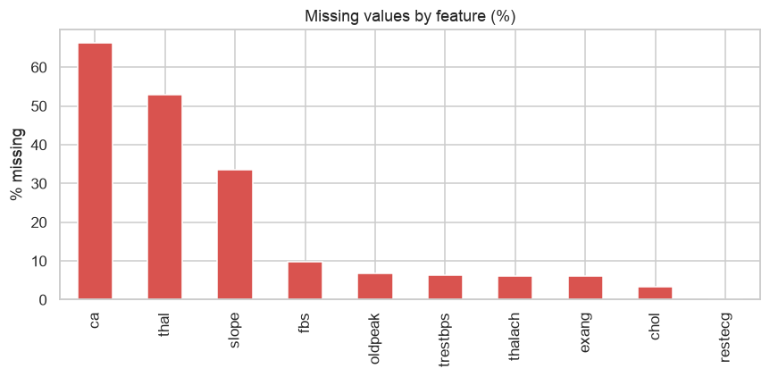
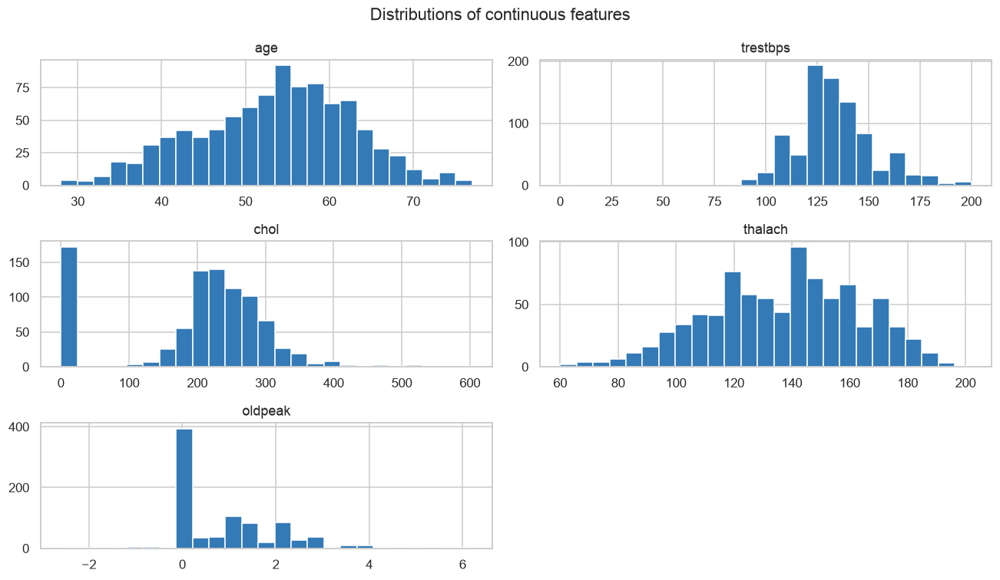
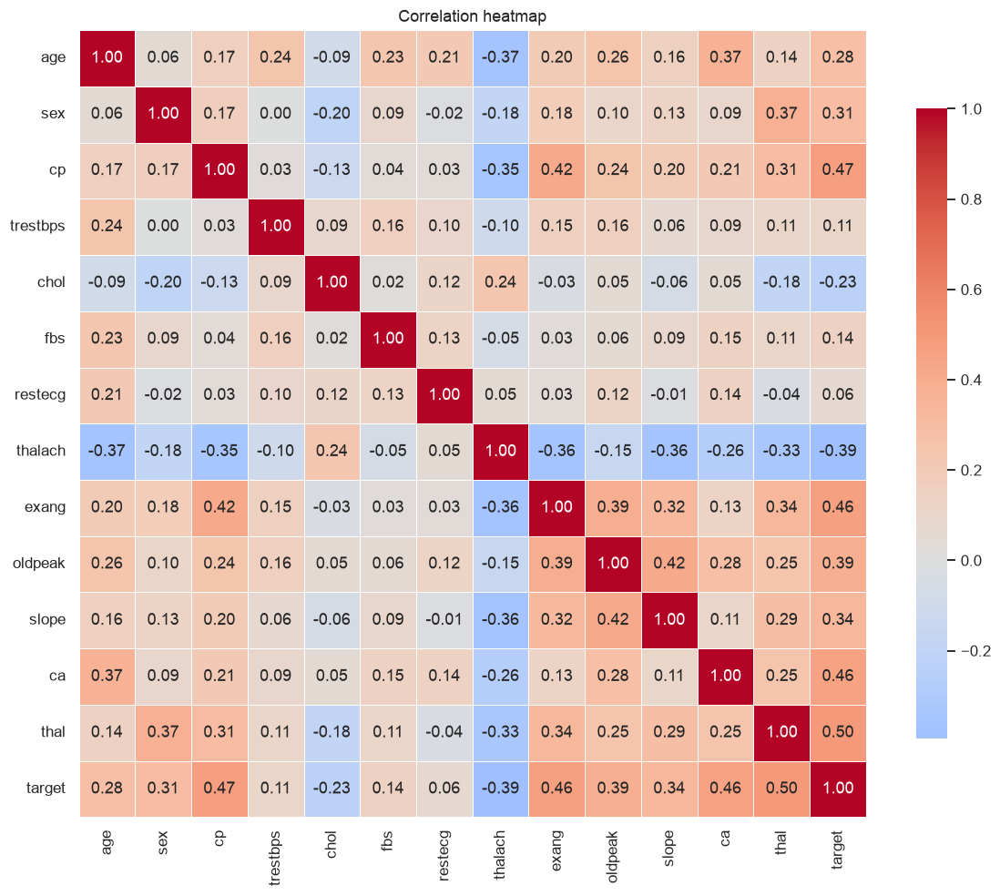
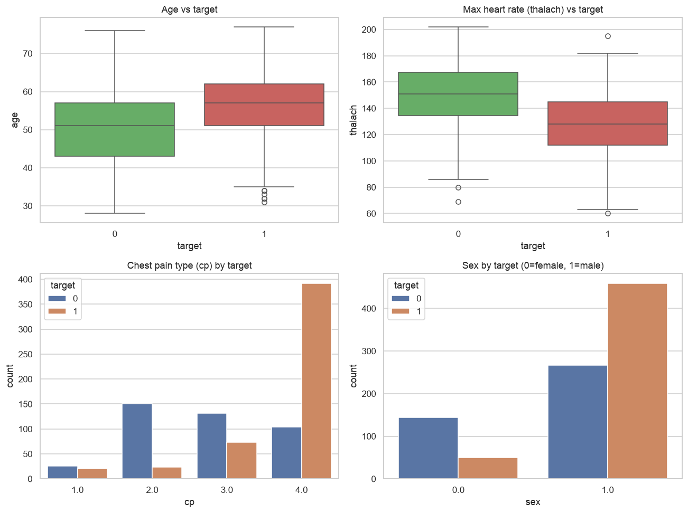
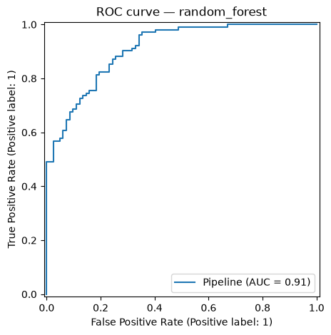
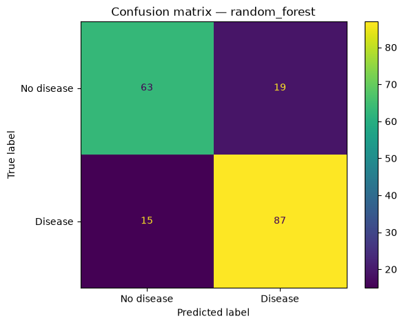
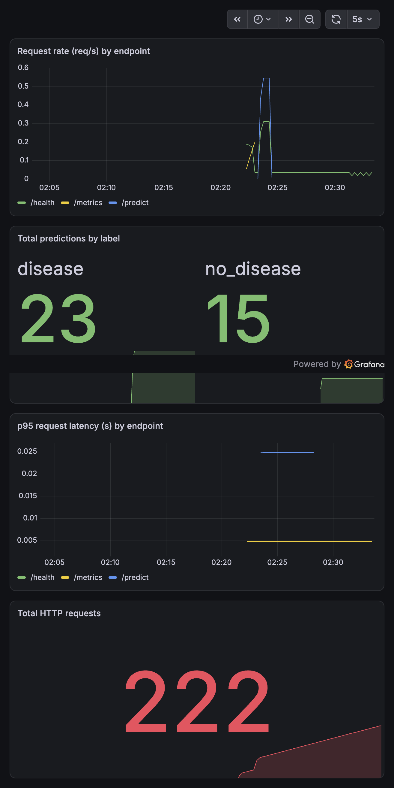

# Heart Disease Prediction — End-to-End MLOps Project Report

**Course:** Machine Learning Operations (MLOps) — AIMLCZG523
**Dataset:** UCI Heart Disease
**Repository:** https://github.com/2025ae05370-Neha/heart-disease-mlops

---

## Table of Contents
1. Introduction & Problem Statement
2. Architecture Overview
3. Setup & Installation
4. Data Acquisition & Exploratory Data Analysis
5. Feature Engineering & Model Development
6. Experiment Tracking (MLflow)
7. Model Packaging & Reproducibility
8. CI/CD Pipeline & Automated Testing
9. Containerization (Docker)
10. Production Deployment (Kubernetes / Minikube)
11. Monitoring & Logging (Prometheus + Grafana)
12. Conclusion

---

## 1. Introduction & Problem Statement

Cardiovascular disease is a leading cause of mortality worldwide, and early risk
screening can meaningfully improve patient outcomes. The goal of this project is
to **build a machine-learning classifier that predicts the risk of heart disease**
from routine patient health measurements, and to **deploy it as a cloud-ready,
monitored API** following modern MLOps best practices.

The project covers the full lifecycle: data acquisition and cleaning,
exploratory analysis, model training with experiment tracking, reproducible
packaging, automated testing with CI/CD, containerization, Kubernetes
deployment, and runtime monitoring.

---

## 2. Architecture Overview

The system is organised into five layers — data/EDA, training & tracking,
CI/CD, serving & deployment, and monitoring.



**Flow summary:** raw UCI files are downloaded and cleaned into a single
dataset; two models are trained and compared, with every run logged to MLflow;
the best model is packaged into a scikit-learn pipeline; a FastAPI service wraps
the model and is containerised with Docker; the container is deployed to a
Kubernetes cluster (Minikube) behind a LoadBalancer; and Prometheus + Grafana
provide request/latency/prediction metrics. GitHub Actions automates linting,
testing, training, and the Docker build on every push.

---

## 3. Setup & Installation

Requires **Python 3.11+** (developed on 3.13), Docker, and (for deployment)
Minikube + kubectl.

```bash
# Create and activate a virtual environment
python3 -m venv .venv
source .venv/bin/activate

# Install dependencies
pip install -r requirements.txt       # readable version ranges
# or: pip install -r requirements-lock.txt   # exact pinned versions

# Reproduce the full pipeline
python src/download_data.py           # download raw UCI data (local fallback)
python src/preprocess.py              # clean + merge -> data/processed/heart.csv
python src/train.py                   # train + tune + log to MLflow
python src/predict.py                 # sample prediction
```

Full setup, Docker, Kubernetes, and monitoring instructions are in the
repository `README.md`.

---

## 4. Data Acquisition & Exploratory Data Analysis

### 4.1 Dataset
The UCI Heart Disease dataset combines records from four hospitals
(Cleveland, Hungary, Switzerland, Long Beach VA), giving **920 patient records**
with **13 clinical features** and a target indicating the presence of heart
disease. A reproducible download script (`src/download_data.py`) fetches the raw
files from the UCI repository, with a local fallback for offline use.

### 4.2 Cleaning
- The four files are merged and column names attached.
- The `?` placeholder is converted to `NaN`.
- The original target `num` (0–4) is binarised: **0 = no disease, 1 = disease**.
- Physically impossible `0` values in `chol`/`trestbps` are treated as missing
  inside the model pipeline.

### 4.3 Key EDA findings

**Class balance** — the target is reasonably balanced (509 disease / 411 none),
so accuracy is informative, though we still report precision/recall/ROC-AUC.



**Missing values** — `ca`, `thal`, and `slope` are missing in most
non-Cleveland records, motivating imputation in the pipeline.



**Feature distributions**



**Correlation heatmap** — the strongest correlations with the target are
`thal`, `cp`, `ca`, `exang`, and `oldpeak`, all consistent with medical
intuition.



**Feature vs target relationships**



---

## 5. Feature Engineering & Model Development

### 5.1 Preprocessing pipeline
All preprocessing is bundled into a scikit-learn `Pipeline` (`src/pipeline.py`)
so that identical transformations are applied at train and serve time:

- **Numeric features** (`age, trestbps, chol, thalach, oldpeak, ca`):
  median imputation + standard scaling.
- **Categorical features** (`sex, cp, fbs, restecg, exang, slope, thal`):
  most-frequent imputation + one-hot encoding.
- A custom step converts impossible `0` values in `chol`/`trestbps` to `NaN`.

### 5.2 Models and tuning
Two classifiers were trained and compared using **5-fold cross-validation** with
`GridSearchCV` (scoring on ROC-AUC), evaluated on a held-out 20% test set:

- **Logistic Regression** — tuned over regularisation strength `C`.
- **Random Forest** — tuned over `n_estimators`, `max_depth`,
  `min_samples_split`.

### 5.3 Results

| Model | Accuracy | Precision | Recall | ROC-AUC |
|-------|----------|-----------|--------|---------|
| Logistic Regression | 0.799 | 0.804 | 0.843 | 0.892 |
| **Random Forest (selected)** | **0.815** | **0.821** | **0.853** | **0.910** |

The **Random Forest** was selected as it outperformed on every metric,
especially ROC-AUC. High recall (0.85) is desirable for a screening tool, where
missing a sick patient (false negative) is costlier than a false alarm.

**ROC curve (Random Forest)**



**Confusion matrix (Random Forest)**



---

## 6. Experiment Tracking (MLflow)

Every training run logs its parameters, metrics, plots, and the serialized model
to **MLflow** (`src/train.py`). Runs are stored under `mlruns/` and viewed with
`mlflow ui`. This provides a full, comparable history of experiments.

> **Insert screenshot:** MLflow runs comparison view and a single run's detail
> (parameters, metrics, artifacts). Save as `screenshots/mlflow_runs.png`.


---

## 7. Model Packaging & Reproducibility

- The final model is saved as `models/heart_model.joblib` — a **complete
  Pipeline** (preprocessing + classifier), so a single file reproduces the full
  inference path.
- The model is also logged in MLflow's model format within each run.
- `requirements.txt` provides readable dependencies; `requirements-lock.txt`
  pins exact versions for byte-for-byte reproducible installs.
- The cleaned dataset (`data/processed/heart.csv`) is committed, and a fixed
  `random_state=42` guarantees deterministic splits and training.

---

## 8. CI/CD Pipeline & Automated Testing

### 8.1 Unit tests
`pytest` tests (in `tests/`) cover data cleaning, the preprocessing pipeline,
and the inference logic — **12 tests** in total, including edge cases such as
fully-missing input rows.

### 8.2 GitHub Actions workflow
`.github/workflows/ci.yml` runs automatically on every push and pull request:

1. Install dependencies
2. **Lint** with ruff
3. **Unit tests** with pytest
4. **Prepare dataset** (download + preprocess)
5. **Train model**
6. **Build the Docker image** and **smoke-test** `/predict`
7. Upload the model and plots as build artifacts

The pipeline fails on any lint/test/build error, giving clear logs.

> **Insert screenshot:** the green GitHub Actions run with its steps expanded.
> Save as `screenshots/ci_pipeline.png`.


---

## 9. Containerization (Docker)

The API is packaged with a slim, non-root `Dockerfile` using Python 3.13 and a
minimal runtime dependency set (`requirements-api.txt`). The container exposes
port 8000, includes a health check, and serves the `/predict` endpoint.

```bash
docker build -t heart-disease-api:latest .
docker run -d -p 8000:8000 --name heart-api heart-disease-api:latest
curl -X POST http://127.0.0.1:8000/predict -H "Content-Type: application/json" \
  -d '{"age":63,"sex":1,"cp":3,"trestbps":145,"chol":233,"fbs":1,"restecg":0,
       "thalach":150,"exang":0,"oldpeak":2.3,"slope":3,"ca":0,"thal":6}'
# -> {"prediction": 1, "label": "disease", "probability": 0.5589}
```

> **Insert screenshot:** successful local `docker run` + curl response, and/or
> the `/docs` Swagger UI. Save as `screenshots/docker_run.png`.


---

## 10. Production Deployment (Kubernetes / Minikube)

The container is deployed to a local Kubernetes cluster (Minikube) using
manifests in `k8s/`:

- **Deployment** — 2 replicas, readiness/liveness probes on `/health`, CPU/memory
  requests and limits.
- **Service** — type `LoadBalancer`, exposing port 80 → container port 8000.

```bash
minikube start --driver=docker
minikube image load heart-disease-api:latest
kubectl apply -f k8s/
kubectl get pods -l app=heart-disease-api
kubectl get svc heart-disease-api
```

The service was verified end-to-end, returning correct predictions through the
cluster.

> **Insert screenshots:** `kubectl get pods` (2 Running), `kubectl get svc`
> (LoadBalancer + EXTERNAL-IP), and a successful curl to the service URL.
> Save as `screenshots/k8s_pods.png` and `screenshots/k8s_service.png`.


---

## 11. Monitoring & Logging (Prometheus + Grafana)

- **Logging:** every API request is logged (method, path, status, and the
  prediction result).
- **Metrics:** the API exposes `/metrics` for Prometheus — request counts,
  request-latency histogram, and prediction counts by label.
- **Dashboards:** a Docker Compose stack (`monitoring/`) runs the API +
  Prometheus + Grafana, with the datasource and dashboard auto-provisioned.

```bash
cd monitoring
docker compose up -d --build
# Grafana:     http://localhost:3000  (admin/admin)
# Prometheus:  http://localhost:9090
```

> **Insert screenshots:** the Grafana "Heart Disease API Monitoring" dashboard
> and the Prometheus targets page. Save as `screenshots/grafana.png` and
> `screenshots/prometheus_targets.png`.




---

## 12. Conclusion

This project delivers a complete, reproducible MLOps pipeline for heart-disease
risk prediction: from raw data to a monitored, containerised API deployed on
Kubernetes, with automated testing and CI/CD. The Random Forest model achieves a
**0.91 ROC-AUC**, and the surrounding infrastructure — experiment tracking,
reproducible packaging, automated pipelines, and runtime monitoring — mirrors
real-world production practice.

**Possible extensions:** model registry and automated promotion, canary
deployments, alerting rules in Prometheus, and drift monitoring on incoming
request data.

---

*Repository:* https://github.com/2025ae05370-Neha/heart-disease-mlops
